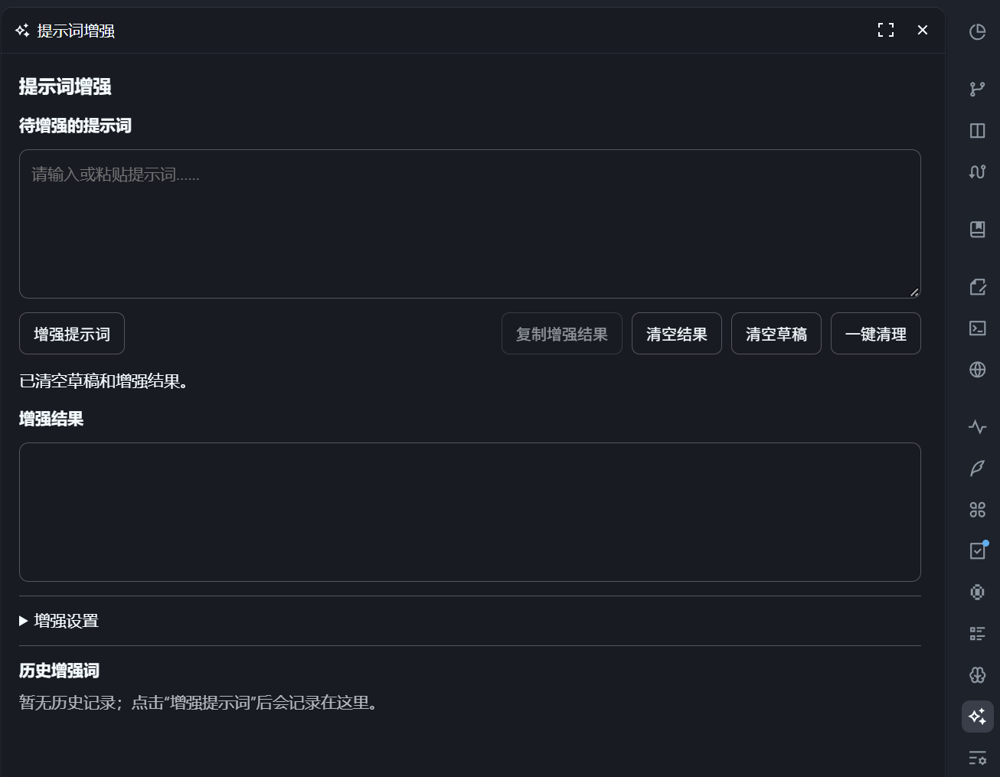
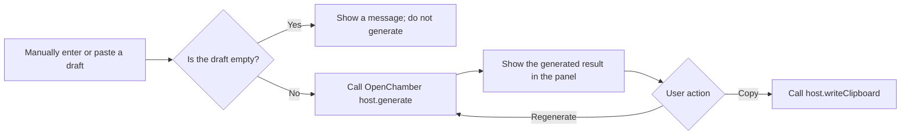

# dsh-prompt-enhance

[](https://github.com/yhweb/openchamber-prompt-enhance/actions/workflows/ci.yml)
[](https://www.npmjs.com/package/dsh-prompt-enhance)
[](./LICENSE)

**A prompt-enhancement extension in a standalone OpenChamber panel.** Enter a draft manually, generate a rewrite with OpenChamber's Small Model, then review, regenerate, or copy the result. The draft and result are not written into a chat session.

[简体中文](./README.md) | English

> **Repository scope:** This is the OpenChamber extension edition of `dsh-prompt-enhance`. The original DeepSeek Harness plugin remains maintained at [rongxingda/dsh-prompt-enhance](https://github.com/rongxingda/dsh-prompt-enhance). Thanks to [Rongxingda](https://github.com/rongxingda) for creating and maintaining the original plugin.

---

## OpenChamber extension

The extension manifest registers a standalone panel at `panel/index.html`; the build generates its panel script. The panel generates results with `host.generate()` using the user's configured Small Model and copies them with `host.writeClipboard()`. The extension requires approval for the manifest's declared `model` capability.

The panel supports manually entering a prompt, generating and viewing a result, regenerating it, browsing the history of enhancements, and saving a custom system prompt and maximum output-token count. The extension does not read or modify the chat composer, inspect conversation history, or send chat messages. The Small Model call does not expose arbitrary provider/model routing, temperature, or reasoning-effort controls.



## Why

The prompt-enhancement panel lets you refine a draft separately without changing the chat composer or conversation. Enter or paste a draft, generate a rewrite, review it, and copy it to the system clipboard for use wherever you choose.

## How it works



The extension manifest declares a standalone panel and the `model` capability. The panel uses the SDK Host API to generate results and extension storage to save settings. It does not connect to DSH host routes or chat-session APIs.

## Requirements

- OpenChamber `>=2.7.0` (the compatibility version declared by the extension manifest).
- Node.js `^22.19.0 || >=24.0.0` to build from source.

## Install

In OpenChamber, go to **Settings → Extensions** and select or add this extension directory. If you checked out the source, run these commands in the repository first:

```bash
npm ci
npm run build
```

Approve the extension's `model` capability when OpenChamber prompts you. Other distribution channels or installation methods: (TBD: verified installation instructions).

## Usage

1. Open the Prompt Enhancer extension panel in OpenChamber.
2. Enter or paste the prompt to enhance.
3. Click **Enhance Prompt** and wait for the result. Click it again to generate another result.
4. Review the result and click **Copy Enhanced Result** to copy it to the system clipboard.
5. Expand **Enhancement Settings** to edit the system prompt and maximum output-token count, then save.

The extension does not apply the result to the chat composer or send a message. To use it in a conversation, paste the copied result yourself.

## History

The panel keeps a history at the bottom: the newest 10 entries, newest first, three visible at a time, with the rest reached by scrolling the list.

Every press of **Enhance Prompt** adds an entry immediately, recording the draft first; the generated result fills that entry when the call finishes, and an entry whose call failed or was cleared reads "not generated yet". Each entry offers **Copy Enhanced** (copies that entry's result) and **Delete**.

Entries live in the extension's global storage namespace (key `history`, no project ID), so the list is the same whichever project the panel is opened from; uninstalling the extension removes it with the namespace.

## Configuration

The panel's **Enhancement Settings** contains the following options, saved in extension storage:

| Setting | Default | Description |
|---|---|---|
| System prompt | Built-in strategy | Controls how the model rewrites prompts; you can replace it with custom text. |
| Maximum output tokens | `2048` | Output limit for one generation. The UI accepts `128` to `4000` and rounds the saved value to a multiple of `128`. |

Saved settings apply to later generations. OpenChamber's Small Model API determines model routing and other generation parameters; the extension does not provide separate controls for them.

## The built-in enhancement strategy

The default system prompt asks the model to organize the role and goal, context and constraints, steps, output format, acceptance criteria, and boundary conditions as needed. It says to add only information that can be inferred from the draft and not to fabricate facts, data, names, or requirements.

The strategy also says to preserve the original intent and scope, output only the rewritten prompt, use the input language, and lightly polish drafts that are already clear. Unknown details should be marked with placeholders such as `(TBD: …)` or `(待补充：…)`. You can replace the default system prompt in the panel settings; the replacement text then defines the strategy used.

## Error handling & edge cases

- A blank draft does not start a generation; the panel asks you to enter text.
- If generation fails, the panel shows an error and keeps the original draft so you can retry.
- If copying fails, the panel shows an error and keeps the generated result visible.
- The extension processes only text that you enter or paste. It does not read conversation history or the chat composer.
- Small Model availability, generation limits, and related errors depend on OpenChamber. The extension does not declare additional model routing or error-recovery behavior.

## Troubleshooting

**Generation fails**

Confirm that OpenChamber has allowed the extension to use the `model` capability and that a Small Model is available. If it still fails, check the error shown in the panel. (TBD: verified steps for specific errors.)

**Settings are not saved**

Reopen the panel and check whether the settings persisted. If the problem continues, check the error information provided by the OpenChamber extension runtime. (TBD: verified handling for extension-storage failures.)

## Architecture

```text
package.json       OpenChamber manifest, panel entry, and model capability
panel/index.html   Standalone panel UI
panel/main.ts      Panel interactions, model call, clipboard, settings, and history storage
src/prompts.ts     Built-in prompt strategy
scripts/build.mjs  Builds the panel and other package entries
```

## Development

```bash
npm ci
npm run typecheck
npm test
npm run build
```

## Acknowledgments

This extension is based on [rongxingda/dsh-prompt-enhance](https://github.com/rongxingda/dsh-prompt-enhance). Thanks to [Rongxingda](https://github.com/rongxingda) for creating and maintaining the original project.

## License

[Apache-2.0](./LICENSE)
