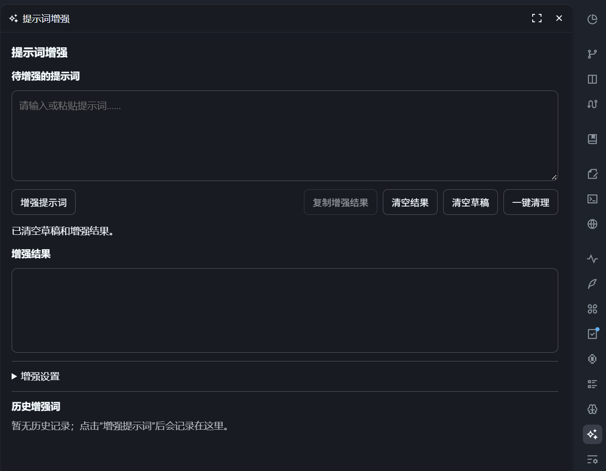
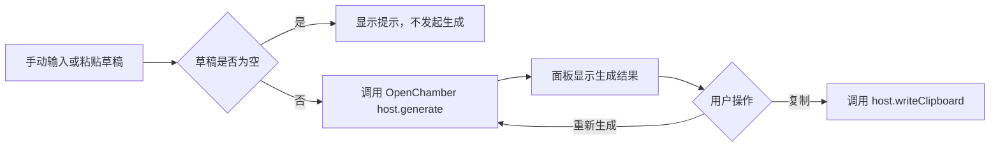

# dsh-prompt-enhance

[](https://github.com/yhweb/openchamber-prompt-enhance/actions/workflows/ci.yml)
[](https://www.npmjs.com/package/dsh-prompt-enhance)
[](./LICENSE)

**OpenChamber 独立面板形式的提示词增强扩展。** 手动输入草稿，使用 OpenChamber 的 Small Model 生成改写结果，在面板中查看、重新生成或复制。草稿和结果不会写入聊天会话。

[English](./README.md) | 简体中文

> **仓库定位：** 本仓库是 `dsh-prompt-enhance` 的 OpenChamber 扩展版本。原版 DeepSeek Harness 插件继续维护在 [rongxingda/dsh-prompt-enhance](https://github.com/rongxingda/dsh-prompt-enhance)。感谢 [Rongxingda](https://github.com/rongxingda) 创建并维护原插件。

---

## OpenChamber 扩展

扩展清单注册独立面板入口 `panel/index.html`，面板脚本由构建生成。扩展使用 `host.generate()` 请求用户配置的 Small Model，并通过 `host.writeClipboard()` 复制结果；安装时需要批准清单声明的 `model` 能力。

面板允许手动输入提示词、生成和查看结果、重新生成，以及保存自定义系统提示词和最大输出 token 数。扩展不读取或修改聊天输入框，不读取会话历史，也不发送聊天消息。Small Model 调用不提供任意 provider/model 路由、temperature 或 reasoning-effort 控制。



## 为什么需要它

提示词增强面板让用户在不改动聊天输入框或会话的情况下，单独整理一份提示词草稿。你可以手动粘贴草稿、生成改写结果、检查结果并复制到系统剪贴板，再按需使用。

## 工作原理



扩展以 OpenChamber 扩展清单声明独立面板和 `model` 能力。面板通过 SDK Host API 生成结果，并用扩展存储保存设置。它不连接 DSH 宿主路由或聊天会话接口。

## 环境要求

- OpenChamber `>=2.7.0`（扩展清单声明的兼容版本）。
- 从源码构建需要 Node.js `^22.19.0 || >=24.0.0`。

## 安装

在 OpenChamber 的**设置 → 扩展**中选择或添加本扩展目录。若从源码检出，先在仓库目录运行：

```bash
npm ci
npm run build
```

按 OpenChamber 提示批准扩展使用 Small Model 的 `model` 能力。其他分发渠道或安装方式：（待补充：经验证的安装说明）。

## 使用方法

1. 在 OpenChamber 中打开“提词增强”扩展面板。
2. 在输入框中输入或粘贴需要增强的提示词。
3. 点击“增强提词”，等待面板显示结果；如需再生成一次，点击“增强提词”。
4. 检查结果并点击“复制增强结果”，将结果复制到系统剪贴板。
5. 展开“增强设置”可编辑系统提示词和最大输出令牌数，然后保存。

扩展不会自动把结果应用到聊天输入框或发送消息。需要在对话中使用时，请自行粘贴复制的结果。

## 配置

面板的“增强设置”提供以下选项，保存在扩展存储中：

| 设置 | 默认值 | 说明 |
|---|---|---|
| 系统提示词 | 内置增强策略 | 控制模型如何改写提示词；可替换为自定义内容。 |
| 最大输出令牌数 | `2048` | 单次生成的输出上限。界面接受 `128` 至 `4000`，保存值按 `128` 的步长归整。 |

设置保存后用于后续生成。模型路由及其他生成参数由 OpenChamber 的 Small Model API 决定，扩展不提供单独配置项。

## 内置增强策略

默认系统提示词要求模型根据草稿需要，整理角色与目标、背景和约束、执行步骤、输出格式、验收标准及边界条件；只补充原文可推断的信息，不编造事实、数据、名称或要求。

策略还要求保留原意和任务范围、只输出改写后的提示词、使用与输入相同的语言，并对已清晰的草稿仅作轻度润色。未知细节应以“(待补充：…)”或“(TBD: …)”等占位符标出。用户可在面板设置中替换默认系统提示词；替换后由用户提供的新内容决定实际策略。

## 异常与边界

- 空白草稿不会发起生成，面板会提示先输入内容。
- 生成失败时面板显示错误；原始草稿仍保留，可以重试。
- 复制失败时面板显示错误，生成结果仍留在面板中。
- 扩展只处理用户手动输入或粘贴的内容，不读取会话历史或聊天输入框。
- 实际可用的 Small Model、生成限制及其错误行为取决于 OpenChamber；扩展没有声明额外的模型路由或错误恢复机制。

## 故障排查

**无法生成结果**

确认 OpenChamber 已允许此扩展使用 `model` 能力，并且 Small Model 可用。若仍失败，请查看面板显示的错误信息。（待补充：针对具体错误的已验证排查步骤。）

**设置无法保存**

重新打开面板并检查设置是否保留；若仍有问题，请查看 OpenChamber 扩展运行环境提供的错误信息。（待补充：扩展存储故障的已验证处理方式。）

## 架构

```text
package.json       OpenChamber 扩展清单、面板入口与 model 能力声明
panel/index.html   独立面板界面
panel/main.ts      面板交互、Small Model 调用、剪贴板与设置存取
src/prompts.ts     内置提示词策略
scripts/build.mjs  构建面板及包内其他入口
```

## 开发

```bash
npm ci
npm run typecheck
npm test
npm run build
```

## 致谢

本扩展基于 [rongxingda/dsh-prompt-enhance](https://github.com/rongxingda/dsh-prompt-enhance) 开发。感谢 [Rongxingda](https://github.com/rongxingda) 创建并维护原项目。

## 许可证

[Apache-2.0](./LICENSE)
